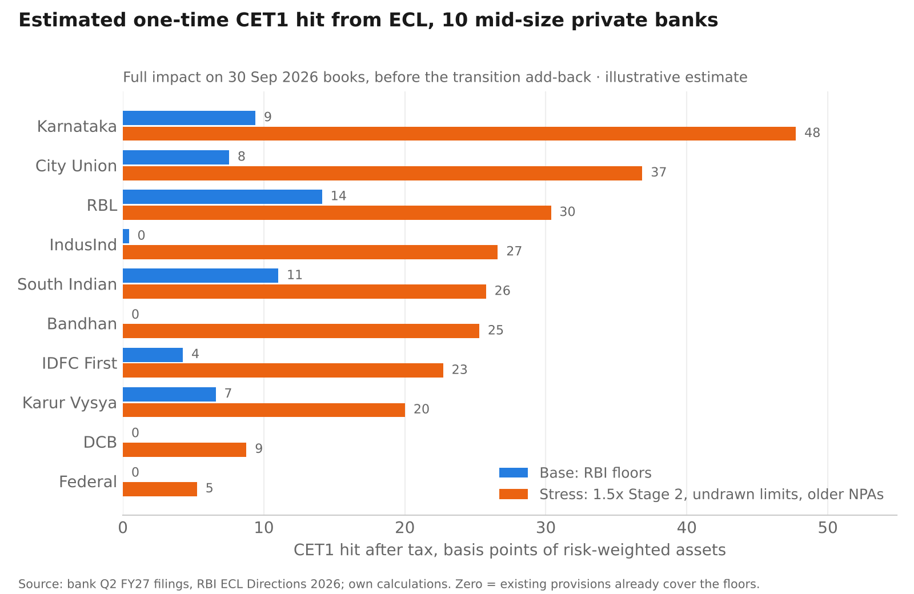

# What will the new ECL rules cost India's mid-size private banks?

My estimate of the one-time cost of expected credit loss (ECL) provisioning for ten mid-size Indian private banks. The RBI's new rules start on 1 April 2027. For each bank I work out how much extra provision the RBI's minimum rates require, how much it already holds, and what the difference does to CET1 capital and book value.

The short version is in the [two-page note](India_Bank_ECL_Note.pdf); the workings are in the [Excel model](India_Bank_ECL_Model.xlsx).

*This is a personal learning project, not investment research. The figures are illustrative estimates under my assumptions, not a view on any bank.*

## What I found

Using figures at 30 September 2026, the RBI's floors on their own cost these banks very little: **0 to 14 bps of CET1** after tax, with a median of about 5 bps. Federal, Bandhan and DCB already hold enough floating, contingent or extra standard-asset provisions to cover them, and IndusInd very nearly does.

A few things stood out while building it:

- **Loan mix decides the rupee amount.** Under the final rules, only unsecured retail (personal loans, cards, microfinance) has a Stage 1 floor above today's rate: 1% against 0.40%. Everything else stays where it is. Home loans to individuals stay at 0.25%; some summaries of the rules quote 0.40%. So IDFC First, IndusInd and Bandhan have the largest Stage 1 requirements; at IDFC First and Bandhan about a quarter of the book is unsecured. IDFC First's large risk-weighted assets and its ₹515 crore contingency buffer still keep its CET1 hit small.
- **Stage 2 is the bigger piece for most banks.** Loans 31 to 90 days overdue go from a 0.40% provision to a 5% floor (1.5% for home, LAP and gold loans). No bank in the sample discloses that bucket for its whole loan book, so I used Crisil's system estimate of about 2.1% for every bank. This is the assumption I'm least sure about.
- **Under stress, the ranking changes.** With Stage 2 half as large again, undrawn limits at 20% of loans and older bad loans needing 80% cover, the range widens to **5 to 48 bps**. Karnataka, City Union, RBL and IndusInd move up because their NPA cover is close to 70%, while mix matters less.
- **Banks' own estimates are much higher than mine.** IndusInd guides to about 1.1% of loans (about ₹4,000 crore), Federal to 1.5-2% of net worth and Bandhan to around ₹2,200 crore. That is roughly 3 to 4 times my stress case. The floors are a backstop: banks also run their own loss models, and for microfinance or vehicle loans those give lifetime losses well above 5%. From public data you can set the minimum and see which levers matter, not reproduce a bank's own number.

## How the model is put together

The workbook starts with a Cover sheet that summarises the outputs and shows whether all the checks pass.

1. **Inputs**: the global assumptions with a Base/Stress switch, and every bank figure with its source. A "what to check" row lists anything derived or approximate, and a "checked by hand" row records whether I've verified each bank against its filing.
2. **Floors**: the Stage 1 and Stage 2 floors from the RBI Directions 2026 (para 82), today's IRACP rates, the Stage 3 schedule and the transition add-backs (4/5, 3/5, 2/5, 1/5).
3. **Loan mix and staging**: each bank's loans sorted into the RBI categories, then split into standard, Stage 1 and Stage 2.
4. **Shortfall**: ECL required at the floors, less the provisions held. Pre-tax and after-tax, with a breakdown of where the shortfall comes from.
5. **Capital and book value**: the CET1 hit, CET1 after the hit, the year-by-year transition, and book value per share before and after.
6. **Sensitivity**: Stage 2 at 1x and 1.5x and undrawn limits at 0%, 10% and 20%, with and without the tax effect, plus the stress case.
7. **Benchmarks**: the model against what banks, Crisil, ICRA and SBI have said, with a line on why each differs.
8. **Assumptions, Checks, Sources, Verification log**: the method in words, integrity checks (including the worked example from my plan), links to every document, and a record of each input checked against its source slide.

## Main assumptions

| | Base | Stress |
|---|---|---|
| Stage 2 share of standard loans | 2.1% (Crisil, May 2026) | 3.15% |
| Undrawn limits after CCF, % of loans | 0% | 20% (top of ICRA's range) |
| Blended Stage 3 floor | 60% | 80% |
| Tax rate on the provision | 25.17% | 25.17% |

I assume existing standard-asset provisions are at today's minimum rates, because most banks don't disclose the stock each quarter (where one does, as IndusInd does, I use its figure). Floating and contingent provisions count in full, as the Directions allow. Risk-weighted assets stay as reported, so the new risk-weight rules that also start on 1 April 2027 are out of scope. I left out Yes Bank because its reported CET1 doesn't yet reflect the Supreme Court ruling on its AT1 bonds.

## Sources

Everything is public: the RBI ECL Directions (27 April 2026) and IRACP Directions, the banks' Q2 FY27 investor presentations, results and call transcripts, and reports from Crisil (May 2026) and ICRA (April 2026). The Sources sheet has the links. Every input was checked against the bank's own slides or results filing; the Verification log sheet lists all 58 checks and what changed. I didn't use any employer data or paid databases.

I used an AI assistant to help extract numbers from the presentations and speed up building the spreadsheet. The method, assumptions and conclusions are my own.

## What I'd improve next

- Update to 31 December 2026 when Q3 FY27 results come out, and add any ECL provisions banks book early
- Replace the system-wide Stage 2 estimate with each bank's own figure as banks start disclosing it
- Use Pillar 3 reports for risk-weighted assets and NPA ageing instead of the stand-ins flagged in the model
- Add the new risk-weight rules, so the result compares like for like with banks such as IDFC First
